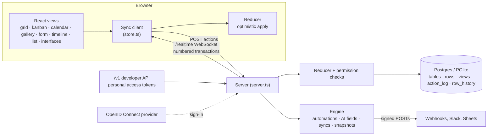

# Architecture

FerTable is one Node.js process: Next.js serves the pages, and the same server handles the
JSON API, the public `/v1` developer API and the live-sync WebSocket. Every change to a base is
an **action**, and one reducer (`src/shared/reducer.ts`) applies actions in both the browser
(instantly, so edits feel immediate) and on the server (to check and save them).



- **Every change is an action** (`row.update`, `field.create`, `view.update`, …).
  The browser applies it right away and sends it to `POST /api/bases/:id/actions`.
- **The server** checks it with the same reducer (`src/shared/reducer.ts`), gives it
  the next per-base **transaction number**, saves the changed rows to Postgres,
  logs it in `action_log`, and broadcasts it over the `/realtime` WebSocket.
- **Clients** apply broadcasts in order. Their own edits come back and are dropped
  from the pending list. A client that reconnects asks for everything after its
  last transaction number.
- **Computed fields** (lookup, rollup, count, formula, created time, autonumber)
  are never stored. They're derived by `src/shared/compute.ts` on both sides.
- **Automations** run on the server after each change and write their own
  transactions (`source: "automation"`), which sync like any other edit.
- **Undo/redo** (⌘Z / ⇧⌘Z, or the arrows in the header): after each of your edits the
  browser stores a patch that reverses it (`src/shared/history.ts`). Undo sends that
  patch as a `restore` action. Rows are restored cell by cell, so other people's
  later edits to the same record are kept. Link cells are saved and undone as
  "link these / unlink those", never as the whole list, so two people linking
  records in the same cell at once both keep theirs. Side effects come back too (a deleted
  field's links, cells and view settings). Saves made while typing in one cell
  undo as one step. History is per tab and survives a reload of that tab (kept in
  `sessionStorage`, about 2 MB, oldest steps dropped first).

```
src/shared   types, ids, reducer, formula language, computed fields, filter/sort/group
src/server   Postgres access (db.ts) and the sync/automation engine (engine.ts)
src/client   sync client (store.ts) and React UI (ui/)
server.ts    one Node server for Next.js pages, the JSON API and WebSockets
research/    REA findings, spec and capture tooling (raw captures are git-ignored)
```

## Other pieces

| Piece | Where | What it does |
| --- | --- | --- |
| Computed values | `src/shared/compute.ts`, `formula.ts` | Lookups, rollups, counts and formulas, worked out on both sides and never stored |
| Undo history | `src/shared/history.ts` | Inverse patches applied as `restore` actions |
| Record history | `src/shared/activity.ts`, `row_history` table | Who changed what, with display text kept as it was then |
| Permissions | `src/shared/permissions.ts` | Field, table and locked-view limits, checked by the server on every change |
| Public links | `src/shared/publicView.ts`, `publicPage.ts`, `publicForm.ts` | What visitors without an account can see or send |
| Developer API | `src/server/publicApi.ts`, `src/shared/api.ts` | Airtable-style REST records API with tokens and rate limits |
| Webhooks and connections | `src/server/webhooks.ts`, `connections.ts` | Signed outgoing posts that refuse private network addresses |
| Synced tables | `src/shared/sync.ts`, `urlSync.ts` | Copies of a view in another base, a Google Sheet or a CSV link |
| Workspaces and access | `src/server/workspaces.ts`, `access` SQL view | A person's role is the higher of their base and workspace roles |
| Single sign-on | `src/server/sso.ts` | OpenID Connect code flow with PKCE and ID-token checks |
| Audit log | `src/server/audit.ts` | Security-relevant events for the admin page |
