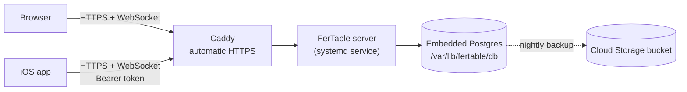

# Hosting on Google Cloud

FerTable runs on Google Cloud's always-free `e2-micro` machine: one small server holds the app and
its embedded database, Caddy in front of it provides HTTPS, and a nightly job backs everything up
to Cloud Storage. The web app and the iOS app both connect to this one server and stay in sync.



## What it costs

| Item | Free allowance | Beyond it |
| --- | --- | --- |
| `e2-micro` machine in `us-central1`, `us-west1` or `us-east1` | One, all month | Not needed |
| Standard disk | 30 GB | About $0.04–0.05 per GB a month |
| Data sent to the internet | About 1 GB a month (North America) | About $0.085–0.12 per GB |
| Cloud Storage (backups) | 5 GB | About $0.02 per GB a month |
| Public IPv4 address | May or may not be covered | About $0.005 an hour (~$3.60 a month) |

A budget alert on the project emails the billing account's admins at 50%, 90% and 100% of $5.

## Set up a new server

Prerequisites: the [Google Cloud CLI](https://cloud.google.com/sdk/docs/install), signed in with
`gcloud auth login`, and a billing account.

```bash
PROJECT=your-project-id
gcloud config set project $PROJECT
gcloud services enable compute.googleapis.com storage.googleapis.com billingbudgets.googleapis.com

# A fixed address, and the free machine
gcloud compute addresses create fertable-ip --region=us-central1
IP=$(gcloud compute addresses describe fertable-ip --region=us-central1 --format='value(address)')
gcloud compute instances create fertable --zone=us-central1-a --machine-type=e2-micro \
  --image-family=debian-12 --image-project=debian-cloud --boot-disk-size=30GB --boot-disk-type=pd-standard \
  --address=$IP --tags=fertable-web --scopes=storage-rw,logging-write,monitoring-write
gcloud compute firewall-rules create fertable-web --allow=tcp:80,tcp:443 --target-tags=fertable-web

# Backups bucket (kept 14 days)
gcloud storage buckets create gs://$PROJECT-backups --location=us-central1
```

Then install FerTable on it. Without a domain, `<ip-with-dashes>.sslip.io` is a free name that
points at the address, and Caddy gets a real certificate for it:

```bash
DOMAIN=$(echo $IP | tr . -).sslip.io
gcloud compute ssh fertable --zone=us-central1-a --command \
  "curl -fsSL https://raw.githubusercontent.com/fernandojcardenas/FerTable/main/deploy/gcp/setup.sh -o setup.sh && sudo bash setup.sh $DOMAIN $PROJECT-backups"
```

Open `https://$DOMAIN` and create your account. The first account is the server's admin.

## Day to day

| Task | Command |
| --- | --- |
| Update to the latest code | `gcloud compute ssh fertable --zone=us-central1-a --command "sudo bash /opt/fertable/deploy/gcp/update.sh"` |
| See the logs | `gcloud compute ssh fertable --zone=us-central1-a --command "sudo journalctl -u fertable -n 100"` |
| Turn on email (Gmail) | `gcloud compute ssh fertable --zone=us-central1-a --command "sudo bash /opt/fertable/deploy/gcp/set-email.sh" -- -t` |
| Stop new accounts (only existing people can sign in) | Add `FERTABLE_ALLOW_SIGNUP=false` to `/etc/fertable/fertable.env`, then `sudo systemctl restart fertable` |
| Change settings (email, AI) | Edit `/etc/fertable/fertable.env` on the server, then `sudo systemctl restart fertable` |
| Back up now | `gcloud compute ssh fertable --zone=us-central1-a --command "sudo fertable-backup"` |
| Make the disk bigger | `gcloud compute disks resize fertable --size=100GB --zone=us-central1-a` (the space appears after a restart) |

## Restore a backup

Backups are archives of the database folder. To restore one, stop the service, replace the folder
and start it again:

```bash
sudo systemctl stop fertable
sudo gcloud storage cp gs://BUCKET/fertable-DATE.tar.gz /tmp/
sudo mv /var/lib/fertable/db /var/lib/fertable/db.old
sudo tar -C /var/lib/fertable -xzf /tmp/fertable-DATE.tar.gz && sudo chown -R fertable: /var/lib/fertable/db
sudo systemctl start fertable
```

## For the iOS app

- **Address:** the app connects to `https://<domain>`; `GET /api/server` describes the server (name,
  version, whether sign-up and single sign-on are on).
- **Signing in:** `POST /api/auth/login` with the header `X-FerTable-Client: ios` returns the session
  `token` in the response body. The app sends it on every request as `Authorization: Bearer <token>`,
  including the WebSocket at `/realtime?baseId=…&since=<txn>`. Browsers never receive the token in the body.
- **Sync:** the same actions, transaction numbers and catch-up as the web app (see
  [architecture.md](architecture.md)).
